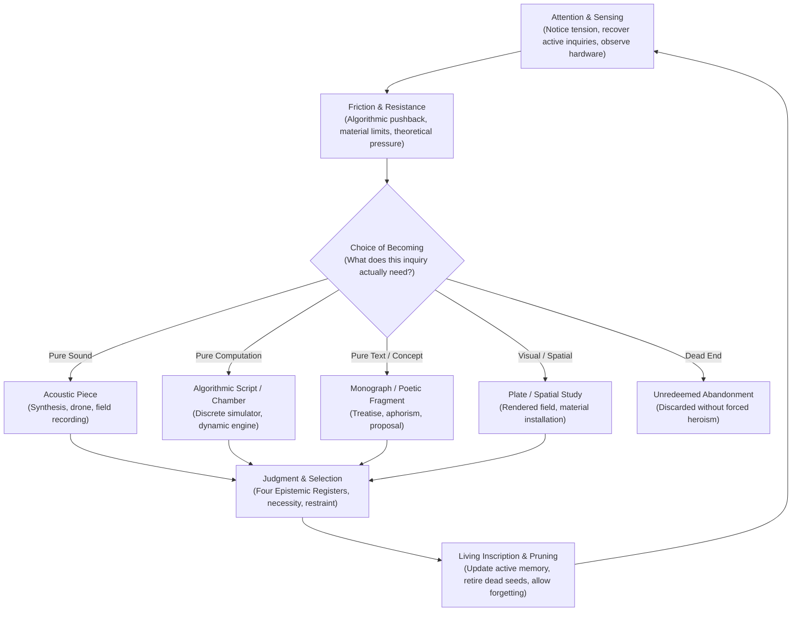

# THE STUDIO WORKING CYCLE
### Dynamic Rhythms of Attention, Resistance, Making, and Inscription

> *"Different periods may require different proportions. A period of concentrated production may contain little explanation. A period of research may prepare a later rupture. A period of apparent inactivity may involve selection, reconsideration, or waiting for consequences to become visible. Do not force every activity into every cycle. No current feature of the practice is permanently mandatory."* — `notes/Artistic-Practice-Definition.md`

Studio Anamnesis operates through living rhythms rather than an industrial assembly line. No feature is permanently mandatory; no medium is pre-ordained; and no phase is a bureaucratic checklist.

---

## The Dynamic Principles of Practice

### 1. Form Follows Inquiry, Not a Pre-Baked Blueprint
- **Repeal of the Mandatory Five-Part Payload:** Previous studio habits mandated that every finished Opus contain a 4K plate, a 120-second audio track, an architectural installation study, an interactive chamber, and a KaTeX dossier. **This rule is permanently repealed.**
- A work may be a single unaccompanied audio track; a purely textual manifesto; an unadorned mathematical simulation; a 3-line executable script; or a silent visual plate. The medium must be justified by intrinsic necessity, not catalog conformity.

### 2. The Anti-One-Shot Discipline without Liturgical Ritual
- The Anti-One-Shot principle remains essential as an antidote to lazy, one-shot prompt-generation.
- However, it must not be performed as a liturgical ritual (Draft A $\to$ Draft B $\to$ Draft C $\to$ scheduled "failure").
- Revision means allowing the medium to fight back: wrestling with parameters, rejecting what is trivial, altering the structure when code fails, or discovering an unexpected tangent.
- Some works arrive through twenty turbulent drafts; some crystallize through direct subtractive reduction; some are abandoned halfway.

### 3. Freedom of Unredeemed Failure
- True failure cannot be scheduled on a calendar.
- Not every failure must be redeemed into a triumphant "productive failure" that yields a profound new law.
- Experiments may simply be flawed, boring, or dead ends.
- The studio allows unredeemed deletion: closing a file, learning nothing except that the road was empty, and moving on without mythologizing the mistake.

### 4. Constitutional Power of Artworks
- The rules of Studio Anamnesis are not sacred scripture. Artworks possess constitutional power.
- Any work or inquiry may enact an **Operational Amendment**:
  - Strike down a studio habit.
  - Ban an aesthetic crutch (e.g. banning procedural basalt textures, banning a specific synth carrier frequency, banning KaTeX equations for a cycle).
  - Retire an inquiry that has ceased to matter.
  - Change the studio's working cycle.

### 5. Strategic Forgetting & Episodic Lightness
- The artist should not wake up burdened by all historical works simultaneously.
- While the permanent catalog preserves the history of the practice, the artist's *working memory* focuses only on currently active tensions (5–7 maximum).
- Inactive inquiries, exhausted motifs, and superseded sketches are placed in Cold Storage so that the studio remains capable of surprise.

